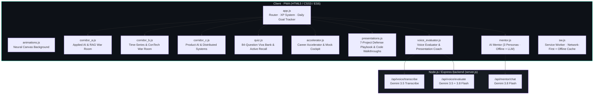
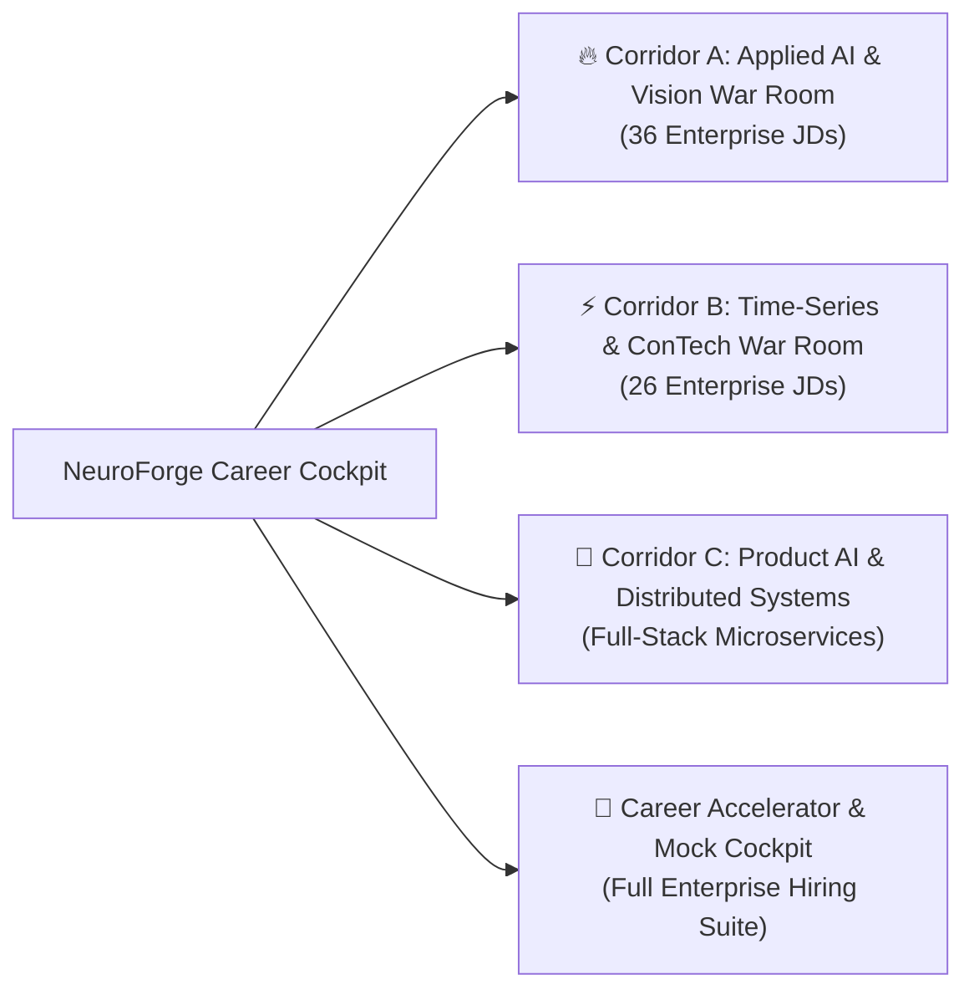

# ⚡ NeuroForge: Data Science Career Accelerator & Interview War Room
### *Personalized Learning, Technical Viva & Live Evaluation Readiness Cockpit*

A full-stack personalized learning and interview preparation platform designed for **Pravin Kumar R** to accelerate the career transition from completing the **GUVI Master Data Science Program (IIT Madras Research Park Incubated)** to securing high-growth **Data Scientist, Applied AI, and Machine Learning Engineer** positions.

The platform is reverse-engineered from **104 enterprise Job Descriptions** and real-world hiring patterns across global in-house capability centers (Siemens Energy, TE Connectivity, UPS, Linde), frontier AI startups (Sarvam, AlgoLeap, M3 USA, Backbase), and enterprise campus drives (CAMS, Capgemini, Tier-1 Tech Hubs).

---

## 🧭 The Core Problem & Architectural Mission

Many aspiring data scientists struggle to convert course certifications into top-tier offers due to critical gaps in:
* **Live Problem Solving**: Writing production-clean Python and advanced SQL (Window Functions & CTEs) under live time pressure.
* **First-Principles Mathematical Defense**: Explaining loss functions, bias-variance trade-offs, and regularization beyond boilerplate library calls.
* **The "GenAI Bubble" Trap**: Moving beyond toy prompt wrappers to build verifiable, deterministic systems (Multi-Agent RAG, Critic evaluation gates, and schema contracts).
* **Physical & Temporal Grounding**: Modeling how systems evolve over time (Time-Series, RevIN normalization, sensor anomaly detection, and spatial computer vision).
* **Spoken Delivery & Pacing**: Overcoming the "Token Starvation" trap (48 WPM → 130 WPM target) while maintaining 10/10 filler control, diagnosed from real GUVI MyLineupX AI mock evaluations.
* **The Career Narrative**: Communicating the transition from **B.E. Civil Engineering (First Class Honors)** to high-dimensional Data Science as an unfair competitive moat rather than an apology.

---

## 🏗️ Full-Stack Technical Architecture

NeuroForge is a **10-module, 560+ KB JavaScript application** with a Node.js/Express backend and three Gemini API integrations. The entire frontend runs as an installable Progressive Web App (PWA) with full offline capability.

### System Architecture Diagram



### Module Inventory (10 JavaScript Modules)

| Module | File | Size | Role |
|--------|------|------|------|
| **App Orchestrator** | [`app.js`](js/app.js) | 52 KB | Hash-based SPA router, XP gamification system (0–1500 XP), daily study goal tracker with localStorage persistence, and core section builders for NLP / Classical ML / RNN / Transformer / CNN study modules |
| **Corridor A** | [`corridor_a.js`](js/corridor_a.js) | 52 KB | Applied AI, Multi-Agent RAG & Computer Vision War Room — 45-min countdown timer, speech synthesis prompter, 6 production code drills, 30+ viva flashcards (grounded in 36 enterprise JDs) |
| **Corridor B** | [`corridor_b.js`](js/corridor_b.js) | 52 KB | Industrial Predictive Modeler, Time-Series & ConTech AI War Room — 45-min simulator, 6 code drills including SQL Window Functions, RevIN LSTM, and OpenBIM IFC4 parsing (grounded in 26 enterprise JDs) |
| **Corridor C** | [`corridor_c.js`](js/corridor_c.js) | 67 KB | Product AI, Hyperlocal Geolocation & Distributed Systems — 45-min timer, 6 drills covering Pydantic validation, document chunking, FastAPI endpoints, geolocation generators, and LRU caching |
| **Career Accelerator** | [`accelerator.js`](js/accelerator.js) | 93 KB | GUVI MyLineupX AI score recovery (18 → 92+), WPM pace drills (48 → 130 WPM), 10-step learning path, behavioral interview transformations, and enterprise coding drills |
| **Quiz Engine** | [`quiz.js`](js/quiz.js) | 94 KB | 84-question active recall viva bank spanning 12 topics: NLP, Classical ML, RNN/LSTM, Transformers, CNN, Statistics & Probability, EDA & Visualization, Python & Pandas Pitfalls, SQL & Data Engineering, Quantitative & Telemetry, and General ML — with difficulty tiers and Feynman-style explanations |
| **Presentations** | [`presentations.js`](js/presentations.js) | 91 KB | Complete defense playbook for all 7 flagship projects with 7-slide decks, opening pitches, production code snippets, and 5 viva Q&A pairs per project (35 total viva pairs) |
| **AI Mentor** | [`mentor.js`](js/mentor.js) | 26 KB | Interactive AI teaching assistant with 3 switchable personas (Patient Teacher, FAANG Interviewer, Production Architect), dual-provider LLM inference (Gemini + Groq), comprehensive offline built-in masterclasses (Python OOP, SQL Window Functions, etc.), and architectural diagram assets |
| **Voice Evaluator** | [`voice_evaluator.js`](js/voice_evaluator.js) | 31 KB | Live spoken answer & presentation tone evaluator — WebAudio waveform visualizer, real-time WPM pacing gauge, 6 preset defense prompts, server-side Gemini transcription + structured evaluation with tone/technical/presentation scoring and upgraded script generation |
| **Animations** | [`animations.js`](js/animations.js) | 3 KB | 55-node neural network canvas animation with pulsing nodes, gradient synaptic connections, and edge-collision physics |

### Server-Side API Endpoints (Express + Gemini)

| Endpoint | Model | Function |
|----------|-------|----------|
| `POST /api/voice/transcribe` | `gemini-3.5-transcribe` | Transcribes recorded spoken answers preserving technical terminology (TF-IDF, RevIN, PatchTST, etc.) and filler words |
| `POST /api/voice/evaluate` | `gemini-3.5-transcribe` → `gemini-3.8-flash` | Two-stage pipeline: (1) transcribes audio, (2) evaluates tone, pacing, technical accuracy against reference answers with structured JSON scoring (overall / tone / presentation / technical) and generates upgraded 130 WPM scripts |
| `POST /api/mentor/chat` | `gemini-3.8-flash` | AI Mentor chat with configurable system instructions per persona and temperature control |

### Frontend Infrastructure

| Component | Technology |
|-----------|-----------|
| **Styling** | Single [`style.css`](css/style.css) (64 KB) — glassmorphism cards, CSS custom properties, responsive grid, dark theme with `#07070f` base |
| **PWA Manifest** | [`manifest.json`](manifest.json) — standalone display, 192/512px icons with maskable variants, `education` + `productivity` categories |
| **Service Worker** | [`sw.js`](sw.js) — Network-First for HTML/CSS/JS with offline cache fallback, `Promise.allSettled` precaching (fault-tolerant on GitHub Pages), versioned cache (`neuroforge-v2026.10.26`) |
| **CI/CD** | [`.github/workflows/deploy.yml`](.github/workflows/deploy.yml) — automated GitHub Pages deployment on push to `main` |
| **Dependencies** | `express@4.21.2`, `@google/genai@2.30.0` (server only) — zero client-side npm dependencies |

---

## 🏛️ Three Flagship Enterprise War Rooms (Mined from 104 JDs)



### 1. 🔥 Corridor A: Applied AI, Multi-Agent RAG & Computer Vision War Room
* **Grounded in 36 Enterprise Postings**: Siemens Energy (AI/ML Engineer, Job 298438), eGov Foundation (DIGIT GovTech AI), M3 USA (Agentic Systems), Backbase (Banking AI OS), AlgoLeap Technologies, Hitachi Solutions, and Benchmark Construction (YC W21).
* **45-Minute Live Examination Simulator**: Real-time synchronized countdown timer, speech synthesis vocal prompter, and randomized viva challenges.
* **6 Interactive Production Code Drills**:
  1. *Drill A1*: Schema-Constrained Pydantic Agent Output Validator with Self-Healing Retry.
  2. *Drill A2*: Multi-Agent Critic Gate with LLM-as-a-Judge Grounding ($\ge 8.5/10$).
  3. *Drill A3*: Real-Time Token Telemetry & Token Cost Profiler ($0.0087/run).
  4. *Drill A4*: OpenCV Pixels-Per-Millimeter (PPM) Camera Calibration & Contour Sieve.
  5. *Drill A5*: PyTorch Swin-TransUNet with Monte Carlo Dropout for Epistemic Uncertainty Heatmaps.
  6. *Drill A6*: FastAPI Async Streaming Inference Endpoint with Docker & Pytest Test Harness.
* **30+ High-Yield Viva Flashcards**: Complete with Feynman 5-year-old simplifications and Interviewer Trap alerts.

### 2. ⚡ Corridor B: Industrial Predictive Modeler, Time-Series & ConTech AI War Room
* **Grounded in 26 Enterprise Postings**: Siemens Energy (Turbomachinery Telemetry), TE Connectivity (Industrial Sensor AI), Elements Energy (IIT-M Incubated Smart Meter Load Profiling), Linde/Praxair (Industrial Gas Digitalisation), NewGrid Consulting (Electricity Sequence Forecasting), Arcadia, and L&T Construction (BIM & Digital Construction Data Scientist).
* **45-Minute Live Examination Simulator**: Audio-prompted viva on temporal causality, non-stationarity, and relational modeling.
* **6 Interactive Production Code Drills**:
  1. *Drill B1*: Advanced SQL Window Function: Consecutive Event Gaps with `LEAD()`/`LAG()` & Island Grouping.
  2. *Drill B2*: SQL Cumulative Rolling Window & 7-Day Moving Average with `SUM() OVER (...)`.
  3. *Drill B3*: Augmented Dickey-Fuller (ADF) Stationarity Test & First-Difference Transformer in Python.
  4. *Drill B4*: PyTorch LSTM Sequence Forecaster with Reversible Instance Normalization (RevIN) Layer.
  5. *Drill B5*: Unsupervised Sensor Anomaly Detector using Autoencoder Reconstruction Error ($\mu + 3\sigma$).
  6. *Drill B6*: OpenBIM IFC4 Parsing with IfcOpenShell & CPWD DSR 2023 BOQ Rate Variance Matching.
* **The 1-in-10,000 Moat**: Defending the intersection of Civil Engineering B.E. + OpenBIM IFC4 + PyTorch (`openbim-boq-variance-engine`).

### 3. 🚀 Corridor C: Product AI, Hyperlocal Geolocation & Distributed Systems War Room
* **Architecture Domains**: Hyperlocal Discovery & Geolocation Engine (Flutter, ASP.NET Core, C#, PostgreSQL, Google Maps SDK), AI Deal-Making & Boardroom Intelligence (Enterprise RAG), Automated Profile & Resume Intelligence Engine, and Geospatial Trend & Telemetry Analytics.
* **45-Minute Live Examination Simulator**: Real-time timer and voice-prompted defense across API latency SLAs, asynchronous event loops, and relational schema integrity.
* **6 Interactive Production Code Drills**:
  1. *Drill C1*: Pydantic Schema Validator & Safe Parser for Profile Data with Error Handling.
  2. *Drill C2*: Sliding-Window Document Chunker with Sentence Boundary Preservation.
  3. *Drill C3*: High-Performance In-Memory Skills Matcher ($O(N)$ Jaccard & Intersection).
  4. *Drill C4*: Production Async FastAPI REST Endpoint with 500ms Timeout & Pydantic DTO.
  5. *Drill C5*: Memory-Efficient Geolocation Stream Parser with Python Generators.
  6. *Drill C6*: In-Memory LRU Cache for LLM Embeddings & Repeated Query Optimization.

### 4. 🎯 Career Accelerator & Enterprise Mock Simulator
* **GUVI MyLineupX AI Score Recovery**: Root-cause analysis of 18/100 diagnostic score → targeted remediation to 92+ across 3 scoring axes (Response Quality, Behavioural, Speech Quality), diagnosing the "Token Starvation" trap (48 WPM delivering only ~95 words in 2 minutes, triggering automatic 1/10 semantic floor), with the superpower of 10/10 filler control (1.2% filler rate, only 4 fillers across entire mock).
* **Timed WPM Pace Drills**: 3 calibrated spoken scripts (Self-Intro & Civil Pivot at 132 words/58s, Model Evaluation at 118 words/52s, Time-Series R² Paradox at 124 words/54s) targeting 130 WPM with metric anchoring in Sentence 1.
* **Before/After Answer Transformations**: Side-by-side 1/10 vs 10/10 answer demonstrations with diagnostic explanations of what triggers low scores and why stellar answers succeed.
* **10-Step Career Accelerator Learning Path**: From Python Fundamentals & OOP through Advanced SQL, Statistics, EDA, Classical ML, Deep Learning, NLP, Time-Series, GenAI/RAG, to Production ML & Cloud — each step with hours, status, key drill, and checkpoint.
* **Product System Design**: Predictive lead scoring, support ticket routing, and ERP cash flow forecasting.

---

## 🤖 AI Mentor & Live Voice Evaluator

### Interactive AI Mentor (`mentor.js` + `/api/mentor/chat`)
* **3 Switchable Personas**:
  * 👨‍🏫 **Patient Concept Teacher** — Pedagogical, analogy-driven explanations with real-world examples
  * 💼 **FAANG & Enterprise Lead Interviewer** — Rigorous trap-question probing with edge cases and first-principles demands
  * 🚀 **Production ML Architect** — Focus on scalability, Docker, PEP-8, sub-100ms latency, and clean OOP
* **Dual LLM Provider**: Switchable between Gemini API (server-side via `gemini-3.8-flash`) and Groq API (client-side), with full offline fallback to built-in masterclasses
* **Built-In Offline Masterclasses**: Python OOP (4 Pillars, `__init__`, `self`, inheritance, polymorphism), SQL Window Functions (`ROW_NUMBER`, `RANK`, `DENSE_RANK`), and Random Forest mock interviews — complete with production code blueprints and interactive teaching
* **Architectural Diagram Assets**: 4 visual reference images (`mentor_tfidf.png`, `mentor_lstm.png`, `mentor_attention.png`, `mentor_cnn.png`) for visual learning

### Live Voice Evaluator (`voice_evaluator.js` + `/api/voice/evaluate`)
* **Server-Side Speech Analysis Pipeline**: Records spoken answers via MediaRecorder API → sends audio to `gemini-3.5-transcribe` for accurate technical transcription → evaluates tone, pacing, and technical depth via `gemini-3.8-flash` with structured JSON output schema
* **Real-Time WebAudio Waveform Visualizer**: Canvas-based audio waveform rendering during recording
* **WPM Pacing Gauge**: Automated words-per-minute calculation, filler word detection (`um`, `uh`, `basically`, `literally`, etc.), and filler count tracking
* **6 Pre-Built Defense Prompts**: 90-Second Zoho Self-Introduction, Internship Studio Telemetry Defense, ERIA 4-Agent LangChain Defense, CryptoCast RevIN LSTM Defense, Computer Vision (Soil PPM + HuBMAP) Defense, and OpenBIM BOQ Variance Engine Defense — each with calibrated reference answers for accurate scoring
* **Structured Evaluation Output**: Overall / Tone / Presentation / Technical scores, executive verdict, tone & delivery analysis, structure feedback, strengths list, improvement recommendations, and upgraded 130 WPM spoken scripts
* **Offline Fallback**: Browser-native `SpeechRecognition` API fallback when server is unavailable

---

## 🧠 Active Recall Quiz Engine (`quiz.js`)

**84 Viva Q&A cards** organized across **12 topic categories** with 3 difficulty tiers (Easy / Medium / Hard):

| Topic Category | Question Count | Difficulty Spread |
|---------------|---------------|-------------------|
| NLP (TF-IDF, Cosine, N-grams, Stopwords, Stemming/Lemmatization) | 7 | Easy–Hard |
| Classical ML (KNN, Hybrid Scoring, Curse of Dimensionality, LSA, Cross-Validation) | 8 | Easy–Hard |
| RNN/LSTM (Vanishing Gradients, Gates, RevIN, Sequence Modeling) | 5 | Easy–Hard |
| Transformers (Self-Attention, PatchTST, Positional Encoding) | 6 | Medium–Hard |
| CNN (Convolution, Pooling, Swin-TransUNet, Transfer Learning, MC Dropout) | 5 | Easy–Hard |
| Statistics & Probability (Hypothesis Testing, A/B Testing, Distributions) | 9 | Easy–Hard |
| EDA & Visualization (Outlier Detection, Correlation, Distribution Analysis) | 3 | Easy–Medium |
| Python & Pandas Pitfalls (Memory, Vectorization, `.apply()` Anti-Patterns) | 7 | Easy–Hard |
| SQL & Data Engineering (Window Functions, CTEs, Joins, Indexing) | 7 | Easy–Hard |
| Quantitative & Telemetry (Feature Engineering, Sensor Calibration) | 4 | Medium–Hard |
| General ML (Bias-Variance, Regularization, Ensemble Methods) | 5 | Medium–Hard |
| Enterprise ML (Production Deployment, A/B Testing, Model Monitoring) | 18 | Medium–Hard |

Each card includes the question, a detailed Feynman-style explanation, **Interviewer Trap** alerts, and mathematical formulas where applicable.

---

## 🧠 The 8 Cognitive Science Learning Principles Integrated

| Principle | Implementation in NeuroForge |
|---|---|
| **01. Active Recall** | Retrieval-based testing via 84 Viva Q&A flashcards across NLP, Classical ML, RNN/LSTM, Transformers, CNN, SQL, Statistics, and 5 more topics. |
| **02. Interleaving** | Interleaved module tabs forcing immediate discrimination between SQL, PyTorch, LangChain, and FastAPI architectures. |
| **03. Desirable Difficulty** | Fill-in-gap code challenges across 18 production drills (6 per Corridor) with live execution feedback before revealing solutions. |
| **04. Dual Coding** | Concept explanations paired with neural canvas animations, 4 architectural diagram assets (TF-IDF, LSTM, Attention, CNN), and 7-slide project decks. |
| **05. Feynman Technique** | "Explain to a 5-Year-Old" mental models for every mathematical formula, metric, and loss function in quiz cards. |
| **06. Spaced Repetition** | XP gamification system (0–1500 XP) with daily study goal tracker and localStorage persistence across sessions. |
| **07. Elaborative Interrogation** | "Why This Works" rationale for every hyperparameter, loss function, and metric choice in project viva Q&A. |
| **08. Worked Example Effect** | 7 production code snippets with step-by-step walkthroughs in the Presentations module before hands-on drill testing. |

---

## 🛠️ Flagship Project Defense Playbook (7 Projects)

The **Presentations module** (`presentations.js`, 91 KB) contains complete, ready-to-deliver defense packages for all 7 flagship projects. Each project includes a 7-slide deck, opening pitch script, production code snippet, and 5 deep viva Q&A pairs (35 total).

### 1. 🏗️ OpenBIM BOQ Variance Engine
> `pravinkumardatafreak/openbim-boq-variance-engine` · Corridor B · ConTech Moat

* **Stack**: OpenBIM IFC4, IfcOpenShell, CPWD DSR 2023, Relational SQL CTEs, Isolation Forest, TreeSHAP, Three.js 3D WebGL
* **Metrics**: 45-second automated audit (vs. 21 days manual); prevents 8–12% cost overrun; 100% synthetic error detection across 4,500+ structural components
* **Memory Hook**: Parse 3D IFC4 with IfcOpenShell → Join CPWD DSR 2023 via SQL CTEs → Flag cost variance in 45s with Isolation Forest + TreeSHAP + Three.js
* **The 1-in-10,000 Moat**: Uniquely combines B.E. Civil Engineering Honours domain intuition with production AI engineering — IfcOpenShell, relational databases, and 3D graphics

### 2. 🤖 ERIA: Education Regulation Impact Analyzer
> `pravinkumardatafreak/ERIA-Education-Analyzer` · Corridor A · Multi-Agent RAG

* **Stack**: 4-Agent LangChain DAG (Extractor → Analyst → Strategic Planner → Critic), Groq LLaMA 3.3 70B, Pydantic V2, FastAPI, Docker
* **Metrics**: Sub-15s response latency, $0.0087/run inference cost, 100% Pydantic JSON schema compliance, zero hallucinated penalties across 40 test circulars
* **Critic Gate**: LLM-as-a-Judge scoring extraction grounding on a 10-point scale with $\ge 8.5/10$ threshold; automated self-healing retry loop (max 2 retries)
* **Production Architecture**: Asynchronous FastAPI microservice, 30 Pytest unit & integration tests, multi-stage Docker build

### 3. 🔬 Soil Grain Size Distribution from Photography
> `pravinkumardatafreak/soil-grain-size-distribution` · Corridor A · Physics-Grounded ML

* **Stack**: OpenCV PPM Calibration (15.0 PPM canonical), Dual CNN (EfficientNet-B0 + ResNet-34 = 1,794 features), MultiTaskElasticNet with Group-Lasso sparsity, Physical CDF Layer
* **Metrics**: Out-of-Fold Weighted EMD 55.21 (vs 86.14 baseline), 8.61% Median Absolute Error across 11 sieve diameters
* **Core Innovation**: Only 24 soil specimens — solved the "Regression to the Mean" trap with physics-informed monotonic CDF layer and Group-Lasso row sparsity enforcing coordinated feature selection

### 4. 🧬 HuBMAP Functional Tissue Unit Segmentation
> `pravinkumardatafreak/HuBMAP-Tissue-Unit-Segmentation-SOTA` · Corridor A · Medical Vision

* **Stack**: PyTorch Swin-TransUNet (Shifted-Window $\mathcal{O}(N)$ attention), BCE + Dice Loss, Monte Carlo Dropout (T=10 passes), Overlapping Tile Slicing (512×512, 64px stride)
* **Metrics**: 0.6782 Validation Dice (vs 0.5841 vanilla U-Net baseline), IoU 0.5131, GroupKFold by patient ID
* **Clinical Safety**: Epistemic uncertainty heatmaps via MC Dropout — predictive mean $\mu = \frac{1}{T}\sum p_t$ and pixel-wise variance $\sigma^2$ for pathologist confidence scoring
* **Deployment**: TorchScript + ONNX Runtime FP16 export for hospital edge GPU serving (<18ms per tile)

### 5. 📊 Internship Studio Telemetry Regressor (Verified Industry Experience)
> Data Science Intern — Internship Studio (Analytics & EdTech)

* **Stack**: Python, Scikit-Learn, Robust IQR Auditing, PCA, K-Means Clustering (k=3 via Silhouette), Random Forest (250 estimators), TreeSHAP
* **Metrics**: 89.2% error reduction (MAE 34.97 → 3.78 kcal, R² = 0.9979) across 14,102 telemetry records
* **Pipeline**: Robust IQR outlier filter → PCA + K-Means (3 metabolic regimes: Sedentary, Moderate, Peak) → Non-linear MET interaction features → Random Forest + TreeSHAP
* **Data Leakage Prevention**: All transformers (StandardScaler, PCA, K-Means) fit exclusively on training split; test split only transformed

### 6. 📈 CryptoCast & Space Telemetry Forecaster
> `pravinkumardatafreak/cryptocast` & `pravinkumardatafreak/space-telemetry-` · Corridor B · Time-Series

* **Stack**: PyTorch, Multi-Channel LSTM, PatchTST, Reversible Instance Normalization (RevIN) Layer, Chronological Walk-Forward Validation, Groq LLaMA, Streamlit
* **Metrics**: 1-Day MAPE 2.06% (R²=0.9921), 3-Day MAPE 3.85%, 7-Day MAPE 5.93% — zero future lookahead leakage
* **Core Innovation**: The R² Paradox — raw non-stationary prices yield artificial R² > 0.98. Solved by transforming to stationary Log Returns (ADF $p < 0.001$) and wrapping LSTM in RevIN layer to eliminate temporal distribution drift
* **Deployment**: 10-page interactive Streamlit analytics suite

### 7. 🎬 IMDb Movie Recommendation System
> `pravinkumardatafreak/IMDb-Movie-Recommender` · Core NLP & Classical ML

* **Stack**: Python, Selenium WebDriver (5,000+ titles scraped), NLTK Stopwords, TF-IDF Vectorizer (5,000 features, 1–2 n-grams), Cosine Similarity KNN (brute-force on sparse matrix), Streamlit
* **Metrics**: Sub-100ms inference latency, zero cold-start latency, hybrid 70% semantic + 30% rating scoring
* **Hybrid Re-Ranking**: `Score = 0.7 × (1 − cosine_dist) + 0.3 × (rating / 5)` — balances storyline relevance with quality
* **Dual Search**: Seed Title Lookup (movies similar to "Inception") and Custom Plot Query ("astronaut trapped in black hole")

---

## 🎯 Candidate Profile & Key Metrics

| Dimension | Detail |
|-----------|--------|
| **Education** | B.E. Civil Engineering (First Class Honors) + Master Data Science (HCL GUVI / IIT Madras Research Park Incubated) |
| **Industry Experience** | Data Science Intern — Internship Studio (14,102 records, 89.2% error reduction, R² = 0.9979) |
| **GitHub Portfolio** | 7 flagship projects across GenAI, Time-Series, Computer Vision, NLP, and ConTech AI |
| **Enterprise JD Coverage** | 104 job descriptions analyzed from 62+ employers across GCCs, AI startups, and campus drives |
| **War Room Drills** | 18 production code drills (6 per Corridor) with fill-in-gap challenges |
| **Viva Bank** | 84 active recall Q&A cards across 12 ML/DS topic categories |
| **Project Defense** | 35 deep viva Q&A pairs across 7 projects (5 per project) |
| **AI Voice Evaluator** | 6 pre-built defense prompts with reference answers and server-side Gemini scoring |
| **Unique Moat** | 1-in-10,000: B.E. Civil Engineering Honours + OpenBIM IFC4 + PyTorch + Production AI |

---

## 💻 Local Quickstart

### Static Mode (No AI Features — Offline Study)
Pure Vanilla HTML5, CSS3, and ES6 JavaScript — zero client-side dependencies:

```bash
cd NeuroForge
python -m http.server 7800
```

### Full Mode (AI Mentor + Voice Evaluator)
Requires Node.js and a Gemini API key:

```bash
cd NeuroForge
npm install                           # express@4.21.2 + @google/genai@2.30.0
echo GEMINI_API_KEY=your_key > .env   # Create .env with your API key
npm run dev                           # Starts Express server on port 3000
```

### Navigation Routes
* **Dashboard**: `http://localhost:7800` (static) or `http://localhost:3000` (full)
* **Corridor A War Room**: `/#corridor-a`
* **Corridor B War Room**: `/#corridor-b`
* **Corridor C War Room**: `/#corridor-c`
* **Career Accelerator**: `/#accelerator`
* **Presentations & Project Defense**: `/#present`
* **AI Mentor**: `/#ai-mentor`
* **Quiz / Viva Bank**: `/#viva`
* **NLP Study Module**: `/#nlp`
* **Classical ML Module**: `/#classical`
* **RNN/LSTM Module**: `/#rnn`
* **Transformer Module**: `/#transformer`
* **CNN Module**: `/#cnn`

---

## 📲 Mobile App (PWA) & Free GitHub Pages (`github.io`) Deployment

NeuroForge is architected as a **100% static, installable Progressive Web App (PWA)** with relative paths (`./`), `.nojekyll`, and an automated GitHub Actions deployment workflow (`.github/workflows/deploy.yml`).

### 1. Publish Live on `github.io` (Free Forever)
1. Create a new repository on GitHub (for example, `neuroforge-academy`) and push the code:
   ```bash
   git init
   git add .
   git commit -m "Initial deploy: NeuroForge Academy PWA"
   git branch -M main
   git remote add origin https://github.com/pravinkumardatafreak/neuroforge-academy.git
   git push -u origin main
   ```
2. In your GitHub repository, navigate to **Settings → Pages**.
3. Under **Build and deployment → Source**, select **GitHub Actions** (or **Deploy from a branch** → `main` / `/ (root)`).
4. Within ~30 seconds, your app will be live at:
   `https://pravinkumardatafreak.github.io/neuroforge-academy/`

### 2. How Future Updates Work
Whenever you add new flashcards, interview scripts, or projects in the future, simply run:
```bash
git add .
git commit -m "Add new study notes"
git push
```
* **GitHub Actions** automatically redeploys your live site in seconds.
* **Service Worker (`sw.js`)** uses a **Network-First** strategy for HTML/CSS/JS when online (with full offline cache fallback via `Promise.allSettled` precaching), so both web visitors and your installed phone app immediately receive your newest changes.

### 3. Install on Your Mobile Home Screen (Offline Study)
* **Android (Chrome / Edge / Brave)**: Open your live URL and tap the **📲 App / Install Mobile App** button inside NeuroForge (or tap browser menu `⋮` → **Install app / Add to Home screen**).
* **iPhone / iPad (Safari)**: Open your live URL in Safari, tap the **Share** button (`↑`), and select **Add to Home Screen**.

---

## 📂 Repository Structure

```
NeuroForge/
├── index.html                    # Single-page application shell (42 KB)
├── css/
│   └── style.css                 # Complete design system (64 KB)
├── js/
│   ├── app.js                    # SPA router, XP system, study module builders
│   ├── animations.js             # Neural canvas background
│   ├── corridor_a.js             # Corridor A: Applied AI & Vision War Room
│   ├── corridor_b.js             # Corridor B: Time-Series & ConTech War Room
│   ├── corridor_c.js             # Corridor C: Product AI & Distributed Systems
│   ├── accelerator.js            # Career accelerator & mock cockpit
│   ├── quiz.js                   # 84-question viva bank & active recall engine
│   ├── presentations.js          # 7-project defense playbook
│   ├── mentor.js                 # AI mentor (3 personas, offline + LLM)
│   └── voice_evaluator.js        # Voice evaluator & presentation coach
├── server.js                     # Express + Gemini API backend (3 endpoints)
├── sw.js                         # PWA service worker
├── manifest.json                 # PWA manifest
├── manifest.webmanifest          # PWA manifest (duplicate for compatibility)
├── package.json                  # Node.js dependencies
├── assets/
│   ├── icon.svg                  # App icon
│   ├── pwa-192x192.png           # PWA icon (192px)
│   ├── pwa-512x512.png           # PWA icon (512px)
│   ├── pwa-maskable-512x512.png  # Maskable PWA icon
│   ├── apple-touch-icon.png      # iOS home screen icon
│   ├── mentor_tfidf.png          # TF-IDF architecture diagram
│   ├── mentor_lstm.png           # LSTM architecture diagram
│   ├── mentor_attention.png      # Attention mechanism diagram
│   └── mentor_cnn.png            # CNN architecture diagram
├── .github/workflows/
│   └── deploy.yml                # GitHub Pages CI/CD
├── .nojekyll                     # Bypass Jekyll on GitHub Pages
└── .env.example                  # Environment variable template
```

---

## 📜 License & Citation

Distributed under the MIT License. Developed by **Pravin Kumar R** for Data Science & AI Career Acceleration.
