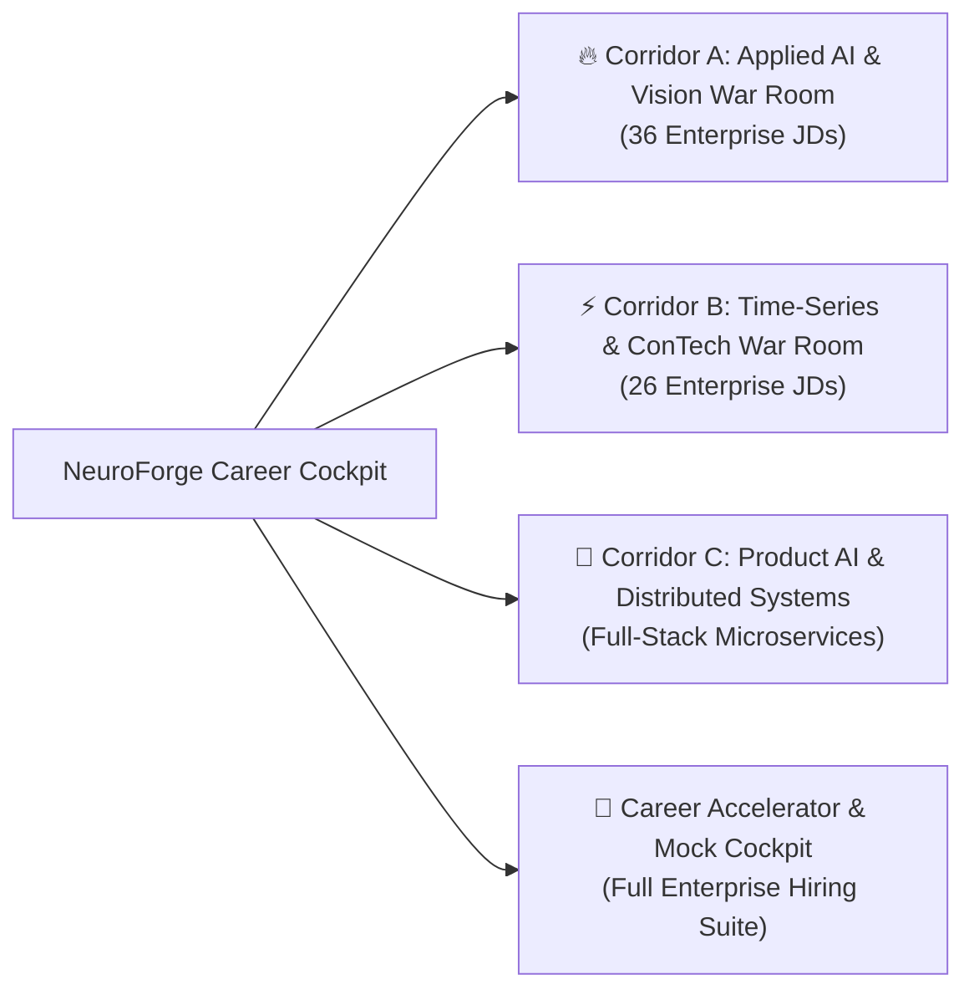

# ⚡ NeuroForge: Data Science Career Accelerator & Interview War Room
### *Personalized Learning, Technical Viva & Live Evaluation Readiness Cockpit*

A personalized learning and interview preparation platform designed for **Pravin Kumar R** to accelerate the career transition from completing the **GUVI Master Data Science Program (IIT Madras Research Park Incubated)** to securing high-growth **Data Scientist, Applied AI, and Machine Learning Engineer** positions.

The platform is reverse-engineered from **104 enterprise Job Descriptions** and real-world hiring patterns across global in-house capability centers (Siemens Energy, TE Connectivity, UPS, Linde), frontier AI startups (Sarvam, AlgoLeap, M3 USA, Backbase), and enterprise campus drives (CAMS, Capgemini, Tier-1 Tech Hubs).

---

## 🧭 The Core Problem & Architectural Mission

Many aspiring data scientists struggle to convert course certifications into top-tier offers due to critical gaps in:
* **Live Problem Solving**: Writing production-clean Python and advanced SQL (Window Functions & CTEs) under live time pressure.
* **First-Principles Mathematical Defense**: Explaining loss functions, bias-variance trade-offs, and regularization beyond boilerplate library calls.
* **The "GenAI Bubble" Trap**: Moving beyond toy prompt wrappers to build verifiable, deterministic systems (Multi-Agent RAG, Critic evaluation gates, and schema contracts).
* **Physical & Temporal Grounding**: Modeling how systems evolve over time (Time-Series, RevIN normalization, sensor anomaly detection, and spatial computer vision).
* **The Career Narrative**: Communicating the transition from **B.E. Civil Engineering (First Class Honors)** to high-dimensional Data Science as an unfair competitive moat rather than an apology.

---

## 🏛️ Three Flagship Enterprise War Rooms (Mined from 62+ JDs)



### 1. 🔥 Corridor A: Applied AI, Multi-Agent RAG & Computer Vision War Room
* **Grounded in 36 Enterprise Postings**: Siemens Energy (AI/ML Engineer, Job 298438), eGov Foundation (DIGIT GovTech AI), M3 USA (Agentic Systems), Backbase (Banking AI OS), AlgoLeap Technologies, Hitachi Solutions, and Benchmark Construction (YC W21).
* **45-Minute Live Examination Simulator**: Real-time synchronized countdown timer, speech synthesis vocal prompter, and randomized viva challenges.
* **6 Interactive Production Code Drills**:
  1. *Drill A1*: Schema-Constrained Pydantic Agent Output Validator with Self-Healing Retry.
  2. *Drill A2*: Multi-Agent Critic Gate with LLM-as-a-Judge Grounding ($\ge 8.5/10$).
  3. *Drill A3*: Real-Time Token Telemetry & Token Cost Profiler ($0.0087/run).
  4. *Drill A4*: OpenCV Pixels-Per-Millimeter (PPM) Camera Calibration & Contour Sieve.
  5. *Drill A5*: PyTorch Swin-TransUNet with Monte Carlo Dropout for Epistemic Uncertainty Heatmaps.
  6. *Drill A6*: FastAPI Async Streaming Inference Endpoint with Docker & Pytest Test Harness.
* **30+ High-Yield Viva Flashcards**: Complete with Feynman 5-year-old simplifications and Interviewer Trap alerts.

### 2. ⚡ Corridor B: Industrial Predictive Modeler, Time-Series & ConTech AI War Room
* **Grounded in 26 Enterprise Postings**: Siemens Energy (Turbomachinery Telemetry), TE Connectivity (Industrial Sensor AI), Elements Energy (IIT-M Incubated Smart Meter Load Profiling), Linde/Praxair (Industrial Gas Digitalisation), NewGrid Consulting (Electricity Sequence Forecasting), Arcadia, and L&T Construction (BIM & Digital Construction Data Scientist).
* **45-Minute Live Examination Simulator**: Audio-prompted viva on temporal causality, non-stationarity, and relational modeling.
* **6 Interactive Production Code Drills**:
  1. *Drill B1*: Advanced SQL Window Function: Consecutive Event Gaps with `LEAD()`/`LAG()` & Island Grouping.
  2. *Drill B2*: SQL Cumulative Rolling Window & 7-Day Moving Average with `SUM() OVER (...)`.
  3. *Drill B3*: Augmented Dickey-Fuller (ADF) Stationarity Test & First-Difference Transformer in Python.
  4. *Drill B4*: PyTorch LSTM Sequence Forecaster with Reversible Instance Normalization (RevIN) Layer.
  5. *Drill B5*: Unsupervised Sensor Anomaly Detector using Autoencoder Reconstruction Error ($\mu + 3\sigma$).
  6. *Drill B6*: OpenBIM IFC4 Parsing with IfcOpenShell & CPWD DSR 2023 BOQ Rate Variance Matching.
* **The 1-in-10,000 Moat**: Defending the intersection of Civil Engineering B.E. + OpenBIM IFC4 + PyTorch (`openbim-boq-variance-engine`).

### 3. 🚀 Corridor C: Product AI, Hyperlocal Geolocation & Distributed Systems War Room
* **Production Focus**: Full-stack AI microservices, automated document intelligence, Pydantic DTO schema validation, and PostgreSQL query optimization.
* **45-Minute Live Examination Simulator**: Real-time timer and voice-prompted defense across API latency SLAs, asynchronous event loops, and relational schema integrity.
* **6 Interactive Production Code Drills**:
  1. *Drill C1*: Pydantic Schema Validator & Safe Parser for Profile Data with Error Handling.
  2. *Drill C2*: Sliding-Window Document Chunker with Sentence Boundary Preservation.
  3. *Drill C3*: High-Performance In-Memory Skills Matcher ($O(N)$ Jaccard & Intersection).
  4. *Drill C4*: Production Async FastAPI REST Endpoint with 500ms Timeout & Pydantic DTO.
  5. *Drill C5*: Memory-Efficient Geolocation Stream Parser with Python Generators.
  6. *Drill C6*: In-Memory LRU Cache for LLM Embeddings & Repeated Query Optimization.

### 4. 🎯 Career Accelerator & Enterprise Mock Simulator
* **Diagnostic Scorecard Recovery**: Diagnostic audio pace drills (increasing speech velocity from 48 WPM to 130 WPM to eliminate evaluator token starvation while leveraging 10/10 filler control).
* **10 Essential Enterprise Python & SQL Drills**: Sliding window moving averages, generator file streaming, `DENSE_RANK()` query patterns, and island grouping.
* **Product System Design**: Predictive lead scoring, support ticket routing, and ERP cash flow forecasting.

---

## 🧠 The 8 Cognitive Science Learning Principles Integrated

| Principle | Implementation in NeuroForge |
|---|---|
| **01. Active Recall** | Retrieval-based testing via 90+ Viva Q&A flashcards across RAG, Time-Series, RevIN, SQL, and Swin-TransUNet. |
| **02. Interleaving** | Interleaved module tabs forcing immediate discrimination between SQL, PyTorch, and LangChain architectures. |
| **03. Desirable Difficulty** | Fill-in-gap code challenges with live execution feedback before revealing production solutions. |
| **04. Dual Coding** | Concept explanations paired with dynamic neural animations and structured architectural sketches. |
| **05. Feynman Technique** | "Explain to a 5-Year-Old" mental models for every mathematical formula and metric. |
| **06. Spaced Repetition** | Structured learning roadmap based on the Ebbinghaus forgetting curve. |
| **07. Elaborative Interrogation** | "Why This Works" rationale for every hyperparameter, loss function, and metric choice. |
| **08. Worked Example Effect** | Verified production implementations (PEP-8 modular scripts) before hands-on drill testing. |

---

## 🛠️ Flagship Project Defense Playbook

* **🤖 ERIA: Education Regulation Impact Analyzer** (`pravinkumardatafreak/ERIA-Education-Analyzer`)
  * 4-Agent LangChain DAG (Extractor, Analyst, Strategic Planner, Critic) powered by Groq LLaMA 3.3 70B.
  * Automated Critic LLM-as-a-Judge validation gate ($\ge 8.5/10$ Grounding), sub-15s FastAPI latency, and strict Pydantic JSON contracts.
* **📈 space-telemetry- & CryptoCast** (`pravinkumardatafreak/space-telemetry-` & `cryptocast`)
  * Multi-channel PyTorch LSTM with Reversible Instance Normalization (RevIN) to eliminate non-stationary distribution drift.
  * Chronological Walk-Forward Validation (WFV) yielding 2.06% 1-day MAPE with zero future lookahead leakage.
* **🏗️ openbim-boq-variance-engine** (`pravinkumardatafreak/openbim-boq-variance-engine`)
  * OpenBIM IFC4 parsing via IfcOpenShell, 3D WebGL visualization, and CPWD DSR 2023 rate matching to detect budget variances.
* **🔬 soil-grain-size-distribution** (`pravinkumardatafreak/soil-grain-size-distribution`)
  * OpenCV Pixels-Per-Millimeter (PPM) camera calibration, group-sparse Multi-Task Elastic Net, 55.21 Out-of-Fold EMD.
* **📊 Internship Studio Telemetry Regressor**
  * Modeled 14,102 records; achieved 89.2% error reduction over baseline (MAE 34.97 down to 3.78, $R^2 = 0.9979$) using PCA, K-Means, and Random Forest.

---

## 💻 Local Quickstart

Pure Vanilla HTML5, CSS3, and ES6 JavaScript — zero heavy runtime dependencies or node_modules bloat:

```bash
# Clone or navigate to the repository
cd NeuroForge

# Start local HTTP server
python -m http.server 7800
```
Open your browser to:
* **Dashboard**: `http://localhost:7800`
* **Corridor A War Room**: `http://localhost:7800/#corridor-a`
* **Corridor B War Room**: `http://localhost:7800/#corridor-b`
* **Corridor C War Room**: `http://localhost:7800/#corridor-c`
* **Career Accelerator & Mock Simulator**: `http://localhost:7800/#accelerator`

---

## 📲 Mobile App (PWA) & Free GitHub Pages (`github.io`) Deployment

NeuroForge is architected as a **100% static, installable Progressive Web App (PWA)** with relative paths (`./`), `.nojekyll`, and an automated GitHub Actions deployment workflow (`.github/workflows/deploy.yml`).

### 1. Publish Live on `github.io` (Free Forever)
1. Create a new repository on GitHub (for example, `neuroforge-academy`) and push the code:
   ```bash
   git init
   git add .
   git commit -m "Initial deploy: NeuroForge Academy PWA"
   git branch -M main
   git remote add origin https://github.com/pravinkumardatafreak/neuroforge-academy.git
   git push -u origin main
   ```
2. In your GitHub repository, navigate to **Settings → Pages**.
3. Under **Build and deployment → Source**, select **GitHub Actions** (or **Deploy from a branch** → `main` / `/ (root)`).
4. Within ~30 seconds, your app will be live at:
   `https://pravinkumardatafreak.github.io/neuroforge-academy/`

### 2. How Future Updates Work
Whenever you add new flashcards, interview scripts, or projects in the future, simply run:
```bash
git add .
git commit -m "Add new study notes"
git push
```
* **GitHub Actions** automatically redeploys your live site in seconds.
* **Service Worker (`sw.js`)** uses a **Network-First** strategy for HTML/CSS/JS when online (with full offline cache fallback), so both web visitors and your installed phone app immediately receive your newest changes.

### 3. Install on Your Mobile Home Screen (Offline Study)
* **Android (Chrome / Edge / Brave)**: Open your live URL and tap the **📲 App / Install Mobile App** button inside NeuroForge (or tap browser menu `⋮` → **Install app / Add to Home screen**).
* **iPhone / iPad (Safari)**: Open your live URL in Safari, tap the **Share** button (`↑`), and select **Add to Home Screen**.

---

## 📜 License & Citation

Distributed under the MIT License. Developed by **Pravin Kumar R** for Data Science & AI Career Acceleration.

